<p align="center">
  <picture>
    <source media="(prefers-color-scheme: dark)" srcset="logos/crates-logo-dark.svg">
    
  </picture>
</p>

<p align="center"><b>Vinyl DJ Librarian.</b> Know which shelf, crate or bag every record is in, play it, and pack it for the gig.</p>

---

Photograph your racks and record bags, then the records in each cubby. Crates files every record to a spot: search **Strings Of Life** and it answers **Kallax 1, shelf A1 (Detroit & Chicago)**, or **bag "Crater"**. Flip through a cubby, move a record in two taps, pack a bag for a gig and check everything back in when you get home. Records play through the YouTube player and fallback chain from [discogs-stream](https://github.com/CarlosFranzetti/discogs-stream).

> **Status:** working prototype (`crates.html`, single file) with a live Neon Postgres schema. The React app is next; see [ROADMAP](docs/ROADMAP.md).

## Screenshots

| Room (Shop floor look): every spot on one screen | Booth look: zoomed into Kallax 1 with the cue bar |
|---|---|
| 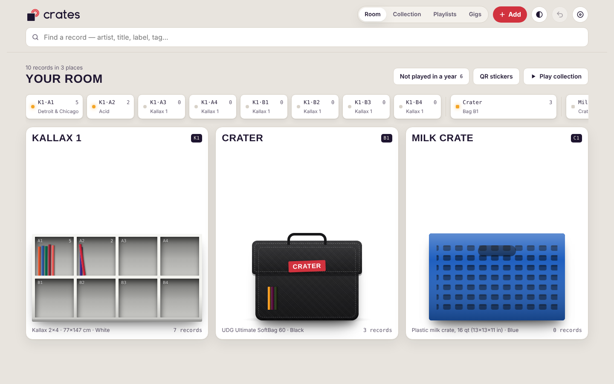 | 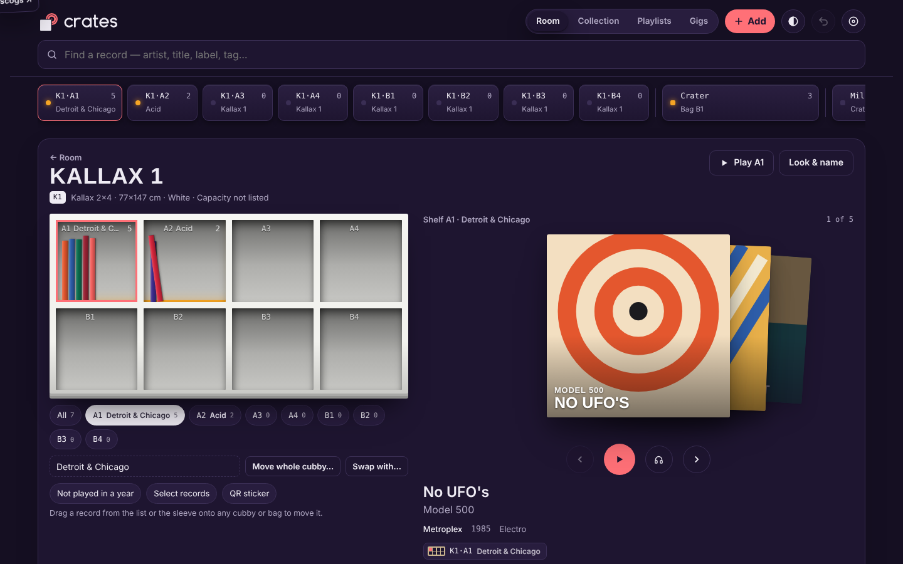 |
| **Collection spreadsheet** | **Player (Booth)** |
| 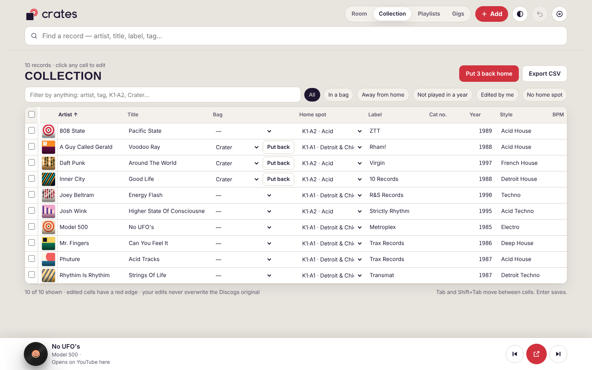 | 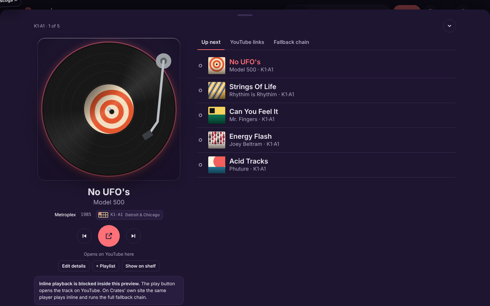 |
| **Slide-up player** | **Gig packing list** |
| 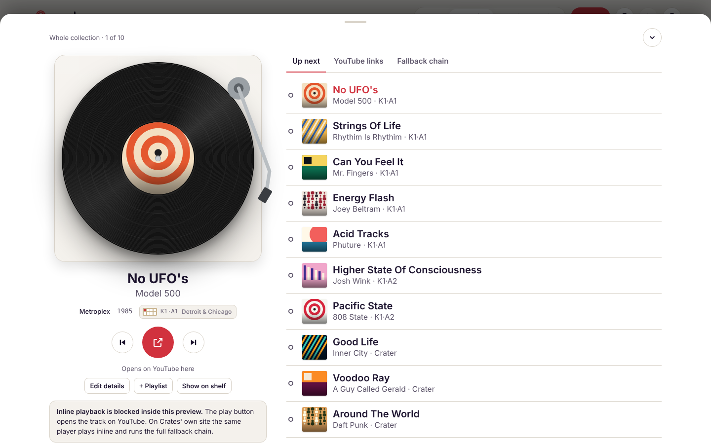 | 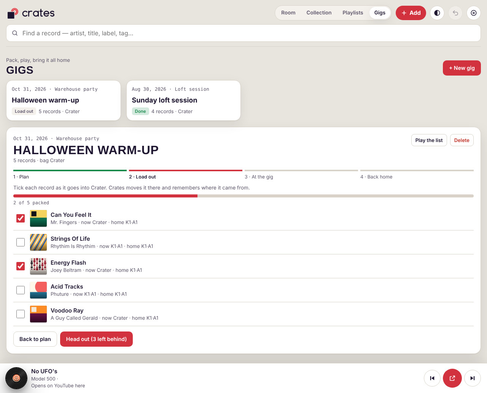 |
| **Add a record: barcode + duplicate warning** | **QR stickers** |
| 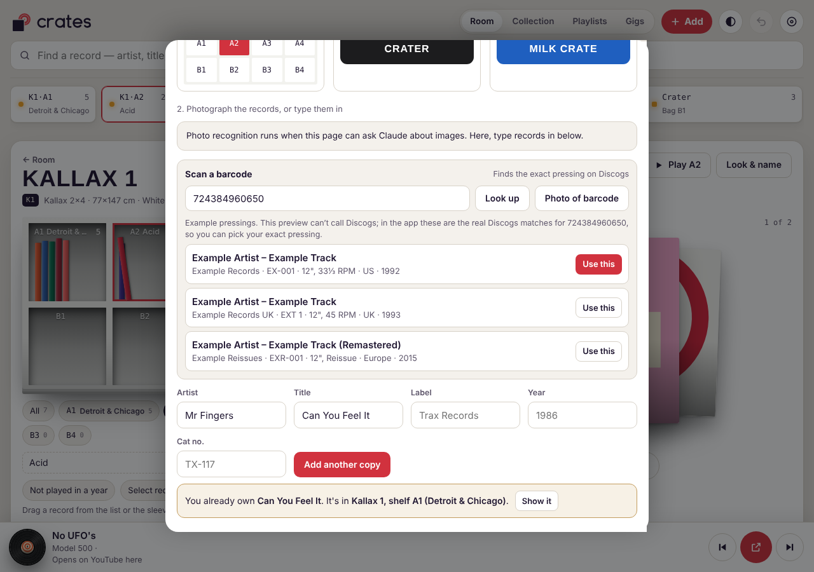 | 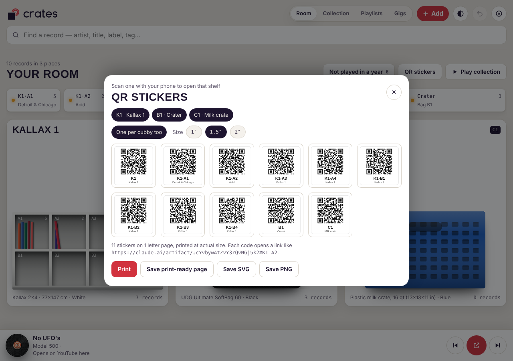 |

<details><summary>Phone screenshots</summary>

| Room | Collection | Player | Gigs | Playlists | Add record |
|---|---|---|---|---|---|
| 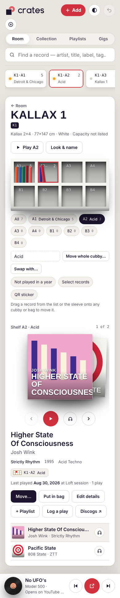 | 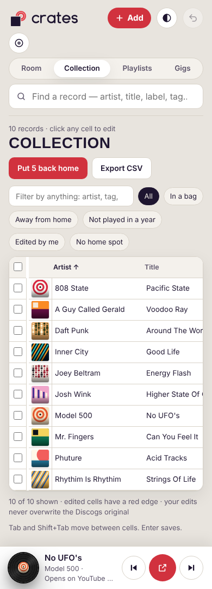 | 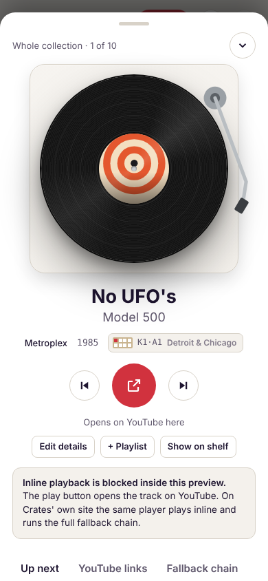 | 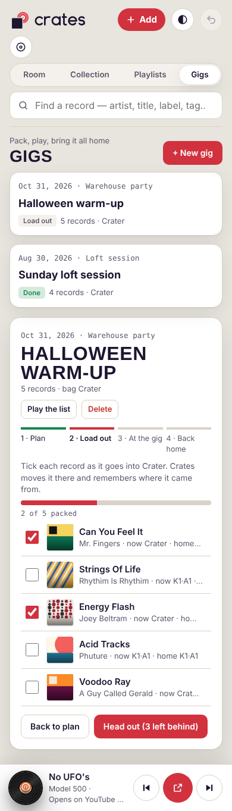 | 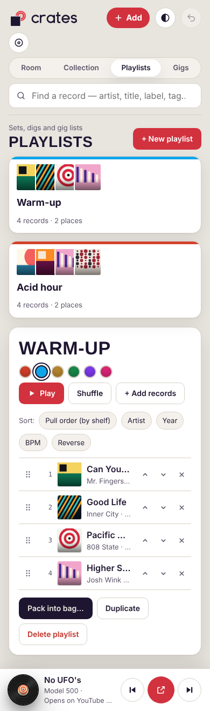 | 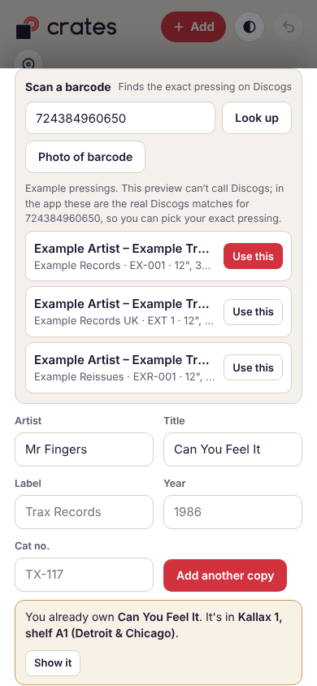 |

</details>

## What it does

- **Two looks.** Shop floor (light) and Booth (dark), or follow your device. A cue bar along the top lists every spot: tap one to open it, or drop a record on it.
- **Room on one screen.** Every rack, bag and crate fits on screen; click one and it zooms in. Drag records between cubbies and bags. Undo goes back step by step (Ctrl/⌘+Z).
- **Previews.** 30 seconds of audio from YouTube, no video, like discogs-stream. The player slides in from the bottom when something plays.
- **Spots, not folders.** Each unit has an ID (K1, B1, C1). Cubbies are rows A, B, C… by columns 1, 2, 3… (`K1·B2`). Give any cubby a subtitle such as "A2 (House)".
- **64 furniture presets and 41 record bags.** Every Kallax/Expedit size, other IKEA, Glorious, Zomo, Pro-Ject, Wax Stacks, crates and boxes; UDG, Magma, Zomo, Odyssey, Reloop, Gator and more. Each has its finishes or colors plus a custom color.
- **Search to shelf.** Artist, title, label, cat no., BPM, key, tags, notes or cubby name, then jump straight to the spot.
- **Move anything.** One record (two taps, with its home slot outlined), a multi-select, a whole cubby, or swap two cubbies. Undo is always available.
- **Bags.** Scan the whole bag to reconcile it. Records in a bag show where they came from, and Put back sends them home.
- **Collection spreadsheet.** Edit details in place, with Bag and Home spot columns for the post-gig put-back and CSV export.
- **Gigs.** Plan → load out → at the gig (log what you played) → back home (anything missing gets flagged).
- **Set history.** Last played, play counts, and a "Not played in a year" dig list.
- **Add records.** Photo, typing or barcode, with a duplicate warning ("You already own this. It's in K1·A1").
- **Discogs.** Your edits never overwrite the original, and locations can be saved to a Discogs "Location" field.
- **QR stickers.** One per unit and per cubby, 1″/1.5″/2″, print-ready. Scanning one opens that exact cubby.
- **Player.** Spinning vinyl, large-font queue, YouTube links and a redundant timeout/fallback chain.

## Docs

| | |
|---|---|
| [PRD.md](PRD.md) | Product requirements, flows and acceptance criteria |
| [HOWTO.md](HOWTO.md) | Using Crates step by step, and developing it |
| [LIST.md](LIST.md) | The big list: every feature, preset, field and table, built or not |
| [FUTURE.md](FUTURE.md) | Ideas beyond what's built |
| [BUGS.md](BUGS.md) | Known bugs and what's been fixed |
| [QA.md](QA.md) | Test catalog, error-handling audit, code review, swarm work packages |
| [CLAUDE.md](CLAUDE.md) | Rules for Claude and agent swarms working in this repo |
| [docs/](docs/) | Architecture, data model, player port spec, roadmap, infrastructure |
| [research/](research/) | Furniture, bag and feature research behind the presets |
| [logos/](logos/) | Logo (concept 3) and the other directions |

## Quick start

```bash
node scripts/build.mjs        # wraps crates.html into dist/index.html
npx serve dist                # open http://localhost:3000

pip install --break-system-packages playwright
CRATES_NO_PATCH=1 python3 tests/test_crates.py   # 53 Playwright tests
```

The prototype keeps its data in your browser (localStorage). The database schema lives in `app/db/` (Neon Postgres, run 001–004 in order).

## Stack

- **Prototype:** HTML, CSS and vanilla JS in one file, with QR generation inlined. It deploys as a static site on Vercel via `vercel.json`, with Vercel Web Analytics and Speed Insights.
- **Planned app:** Vite + React + TypeScript + Tailwind, Vercel functions, Neon Postgres and the Discogs API, with the YouTube player ported from discogs-stream.

---

<sub>Data from Discogs is used under the Discogs API terms. Crates is not affiliated with Discogs or IKEA.</sub>
