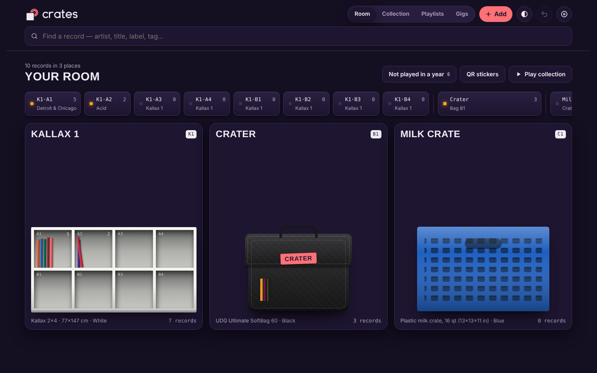
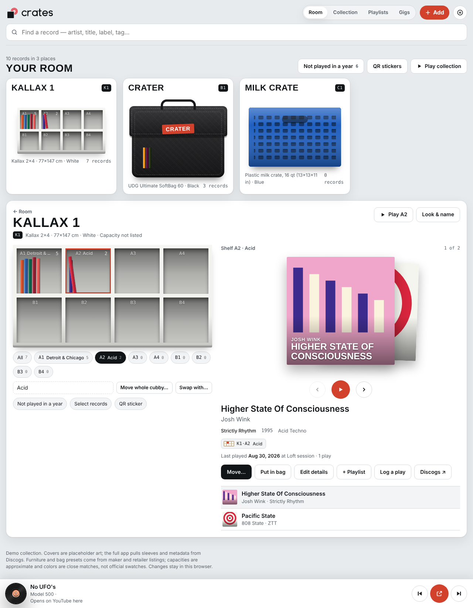
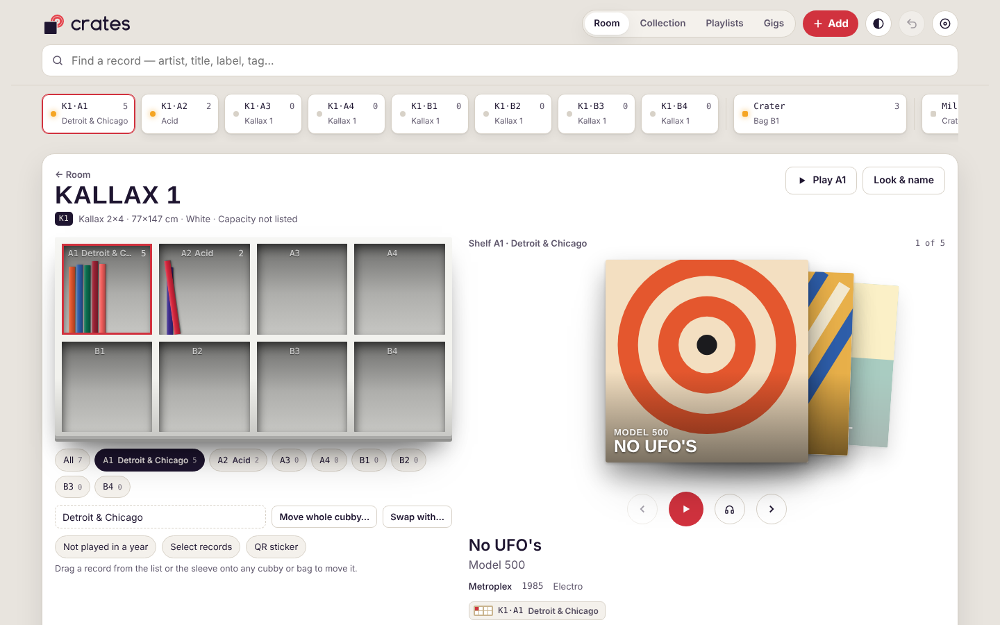
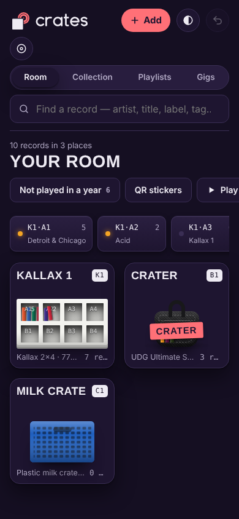

<p align="center">
  <picture>
    <source media="(prefers-color-scheme: dark)" srcset="logos/crates-logo-dark.svg">
    
  </picture>
</p>

<p align="center"><b>Vinyl DJ Librarian.</b> Version 0.8b. Know which shelf, crate or bag every record is in, play it, and pack it for the gig.</p>

<p align="center"><a href="https://crates-livid.vercel.app/"><b>Open the live app → crates-livid.vercel.app</b></a></p>

---

Crates maps your record collection to the furniture it actually lives in. Photograph your racks and record bags, then the records in each cubby, and every record gets a spot. Search **Strings Of Life** and the answer is **Kallax 1, shelf A1 (Detroit & Chicago)** or **bag "Crater"**. You can flip through a cubby, move a record with two taps or a drag, pack a bag for a gig and check it all back in when you get home. Records play through the YouTube player and fallback chain from [discogs-stream](https://github.com/CarlosFranzetti/discogs-stream).

> **Status:** working prototype (`crates.html`, a single file) deployed on Vercel, plus a live Neon Postgres schema. The React app comes next; see [ROADMAP](docs/ROADMAP.md).

## Screenshots

The app opens in the dark **Booth** look. The switch at the top (◐) changes it to the light **Shop floor** look or to match your device.

| Your room: every rack, bag and crate on one screen | Zoomed into Kallax 1: shelves, sleeve stack and details |
|---|---|
|  |  |
| **Shop floor look (light)** | **Collection spreadsheet** |
|  |  |
| **Player** | **Gig packing list** |
|  |  |
| **Add a record: barcode and duplicate warning** | **QR stickers** |
|  |  |

<details><summary>Phone screenshots</summary>

| Room | Kallax 1 | Collection | Player | Gigs | Add record |
|---|---|---|---|---|---|
|  |  |  |  |  |  |

</details>

## What it does

**Where things are**
- **Spots, not folders.** Each unit has an ID (K1, B1, C1). Cubbies are rows A, B, C… by columns 1, 2, 3…, so `K1·B2` is Kallax 1, second row, second cubby. Any cubby can have a subtitle such as "A2 (Acid)".
- **Your room on one screen.** Every rack, bag and crate fits on screen. Click one and it zooms in.
- **Cue bar.** A row along the top lists every cubby and bag. Tap one to open it, or drop a record on it.
- **Search to shelf.** Search by artist, title, label, cat no., BPM, key, tags, notes or cubby name, then jump straight to the spot.
- **64 furniture presets and 41 record bags.** Every Kallax/Expedit size, other IKEA, Glorious, Zomo, Pro-Ject, Wax Stacks, crates and boxes, plus UDG, Magma, Zomo, Odyssey, Reloop, Gator and more. Each comes in its real finishes or colors, or a custom color. New bags start as "Bag 1", "Bag 2".

**Moving records**
- **Drag and drop** between cubbies and bags (long-press on touch screens).
- **Two-tap moves** for one record, with its home slot outlined.
- **Bulk moves:** a multi-select, a whole cubby, or a swap between two cubbies.
- **Multi-step undo** for every move (Ctrl/⌘+Z).
- **Bags remember where records came from.** Scan the whole bag to reconcile it, and Put back sends everything home.

**Playing and gigs**
- **Player.** Spinning vinyl, a large-font queue, YouTube links and a redundant timeout/fallback chain. It slides up from the bottom the first time something plays.
- **30-second previews.** Audio only, no video, like discogs-stream.
- **Gigs.** Plan, load out, log what you played at the gig, and check in back home (anything missing gets flagged).
- **Set history.** Last played, play counts, and a "Not played in a year" dig list.

**Your data**
- **Collection spreadsheet.** Edit details in place, use the Bag and Home spot columns for the post-gig put-back, and export to CSV. Laid out for landscape.
- **Adding records.** By photo, typing or barcode, with a duplicate warning ("You already own this. It's in K1·A1").
- **Discogs.** Your edits never overwrite the original, and locations can be saved to a Discogs "Location" field.
- **QR stickers.** One per unit and per cubby, in 1″, 1.5″ or 2″, ready to print. Scanning one opens that exact cubby on the live site.

Barcode lookups and Discogs sync are simulated in the prototype and say so in the app. The real calls go server-side in the React app.

## Docs

| | |
|---|---|
| [PRD.md](PRD.md) | Product requirements, flows and acceptance criteria |
| [HOWTO.md](HOWTO.md) | Using Crates step by step, and developing it |
| [LIST.md](LIST.md) | The big list: every feature, preset, field and table, built or not |
| [FUTURE.md](FUTURE.md) | Ideas beyond what's built |
| [BUGS.md](BUGS.md) | Known bugs and what's been fixed |
| [QA.md](QA.md) | Test catalog, error-handling audit, code review, swarm work packages |
| [CLAUDE.md](CLAUDE.md) | Rules for Claude and agent swarms working in this repo |
| [docs/](docs/) | Architecture, data model, player port spec, roadmap, infrastructure |
| [research/](research/) | Furniture, bag and feature research behind the presets |
| [logos/](logos/) | The logo (concept 3, "Half-pulled") and the other directions |

## Quick start

```bash
node scripts/build.mjs        # wraps crates.html into dist/index.html
npx serve dist                # open http://localhost:3000

pip install --break-system-packages playwright
CRATES_NO_PATCH=1 python3 tests/test_crates.py   # 53 Playwright tests
```

The prototype keeps its data in your browser (localStorage), so each browser has its own collection. The database schema lives in `app/db/` (Neon Postgres; run 001–004 in order).

## Deploy

Live at **https://crates-livid.vercel.app/**. Vercel builds it from `vercel.json`:

- **Framework preset:** Other.
- **Build command:** `node scripts/build.mjs`.
- **Output directory:** `dist`.
- **Install command:** none.

The build adds the page title, favicon, Vercel Web Analytics and Speed Insights. `vercel.json` also sets the security headers (CSP, and camera allowed for barcode photos).

## Stack

- **Prototype:** HTML, CSS and vanilla JS in one file, with QR generation inlined and the barcode reader (ZXing) loaded on demand. Static site on Vercel.
- **Planned app:** Vite + React + TypeScript + Tailwind, Vercel functions, Neon Postgres and the Discogs API, with the YouTube player ported from discogs-stream.

## Credits

Version 0.8b. **Thought up by Carlos Franzetti.** **Put into motion by Claude and the Crates crew** — the research, build and review agents that work in this repo.

---

<sub>Data from Discogs is used under the Discogs API terms. Crates is not affiliated with Discogs or IKEA.</sub>
