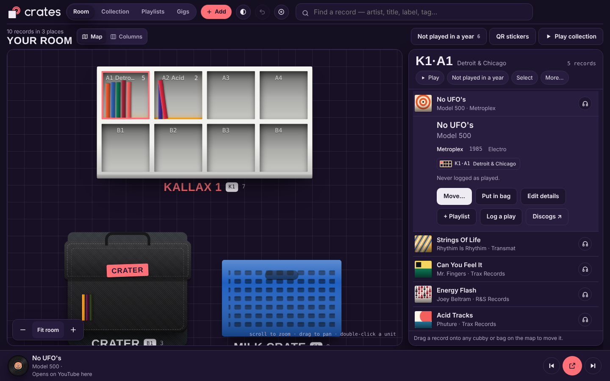
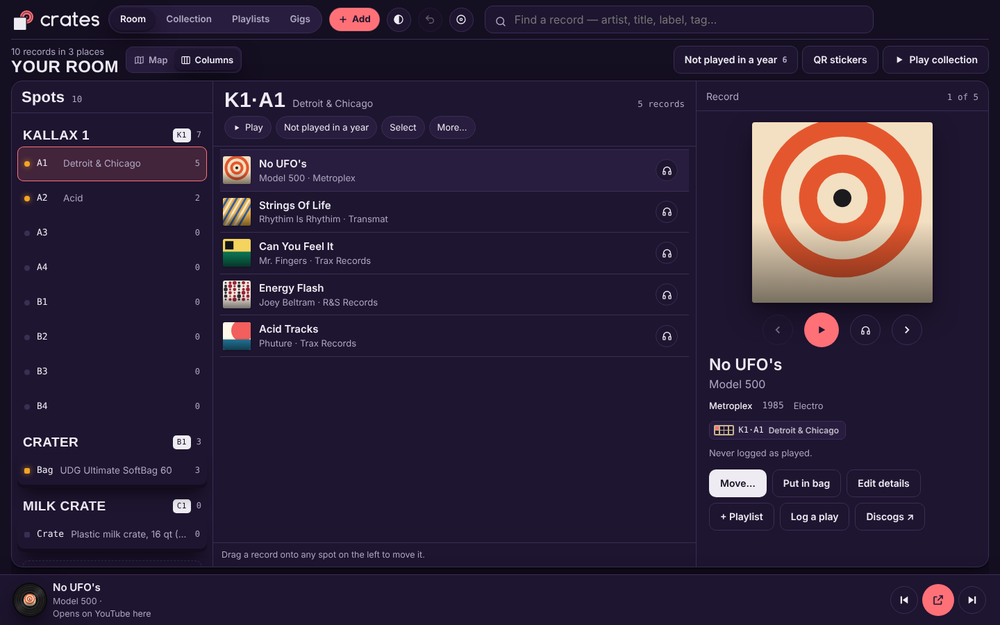
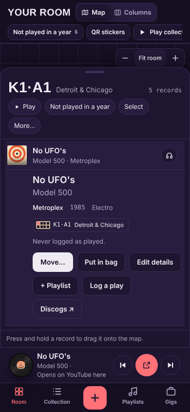
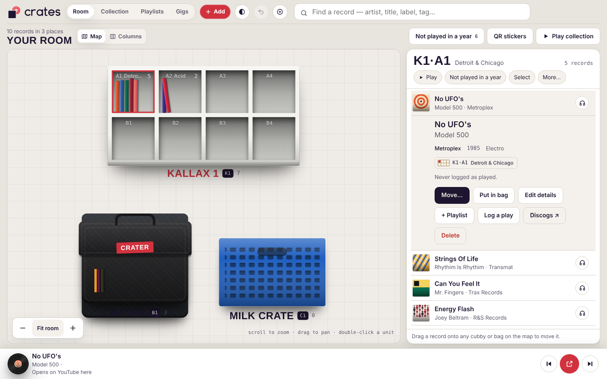
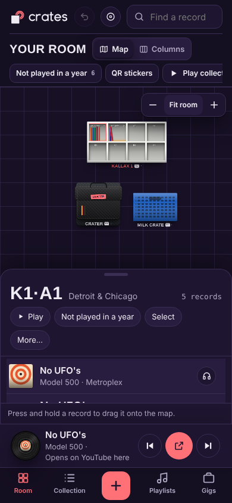
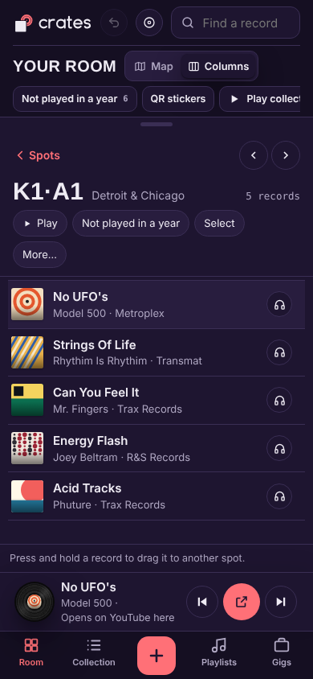

<p align="center">
  <picture>
    <source media="(prefers-color-scheme: dark)" srcset="logos/crates-logo-dark.svg">
    
  </picture>
</p>

<p align="center"><b>Where's that record?</b><br>Crates knows. Kallax 1, shelf A2. Or the bag you took to the loft last Friday.</p>

<p align="center"><a href="https://crates-livid.vercel.app/"><b>▶ Play with it: crates-livid.vercel.app</b></a> · v0.8b</p>

---

Crates is a vinyl librarian for DJs. Draw your shelves, crates and bags, drop your records in, and it remembers every spot. Search a record and it answers with a place, not a folder. Pack a bag for a gig, log what you played, put it all back when you get home. Press play and you can hear your collection wherever you are.



## The good stuff

- **Two ways to look at your room.** **Map** draws your furniture on a canvas you pan and pinch. **Columns** goes spots → records → record, Finder-style. Switch any time; it remembers.
- **Tap a cubby, get the records.** Side panel on desktop, a slide-up overlay on your phone. Nothing on the page ever scrolls.
- **Addresses that make sense.** `K1·B2` is Kallax 1, row B, cubby 2. Name a cubby "Acid" and it shows up everywhere.
- **Move things like a human.** Drag a sleeve onto any cubby or bag. Two taps for one record. Multi-select, move a whole cubby, swap two. Undo as far back as you like.
- **64 racks, 41 bags.** Every Kallax, plus Glorious, Zomo, UDG, Magma, milk crates in all the colors. Pick a finish, or your own.
- **Gigs.** Plan, pack, play, put back. Anything missing gets flagged. "Not played in a year" is one tap away.
- **The player.** Spinning vinyl, big-type queue, drag to seek, pinch the record to read the label. The next link is cued before you need it, and links that work are saved.
- **Collection spreadsheet.** Edit in place, every container along the top, drag a row onto one to move it. Borderless, because it should look good.
- **Backups you don't have to think about.** Four rolling snapshots, made before every import, restore and reset. Save the whole thing to a file. Import your Discogs CSV. Upload to Discogs only after it has pulled and backed up what's there.
- **QR stickers** for every unit and cubby. Scan one, land on that cubby.
- **Dark by default.** Booth look, or Shop floor if you're a morning person.

| Columns | Collection | Phone |
|---|---|---|
|  |  |  |

<details><summary>More screenshots</summary>

| Shop floor look | Player | Gig packing | Add + duplicate check | QR stickers |
|---|---|---|---|---|
|  |  |  |  |  |

| Map | Columns | Collection | Player | Add record |
|---|---|---|---|---|
|  |  |  |  |  |

</details>

## Run it

```bash
node scripts/build.mjs && npx serve dist          # http://localhost:3000
CRATES_NO_PATCH=1 python3 tests/test_crates.py    # 66 Playwright tests
```

One HTML file, no framework, no build beyond wrapping. Your data lives in your browser until the real backend lands (Neon schema in `app/db/`, 001–005). Deploys to Vercel from `main` with `vercel.json` (preset Other, `node scripts/build.mjs`, output `dist`).

## Read more

[HOWTO](HOWTO.md) · [PRD](PRD.md) · [the big LIST](LIST.md) · [FUTURE](FUTURE.md) · [BUGS](BUGS.md) · [QA](QA.md) · [docs/](docs/) · [research/](research/) · [CLAUDE.md](CLAUDE.md) for the agents

## Credits

Thought up by **Carlos Franzetti**. Put into motion by **Claude and the Crates crew**.

<sub>Discogs data is used under the Discogs API terms. Not affiliated with Discogs or IKEA. The crew is not responsible for records you suddenly want to buy.</sub>
